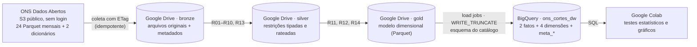
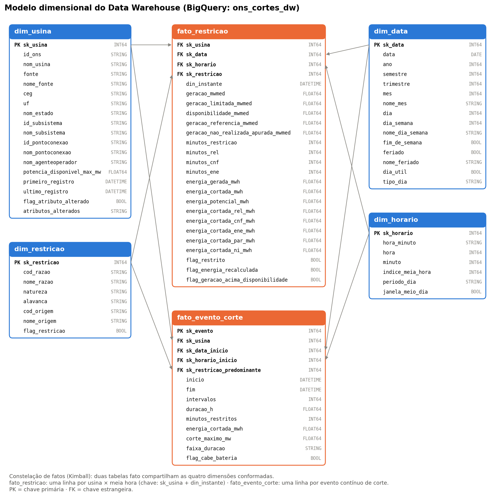
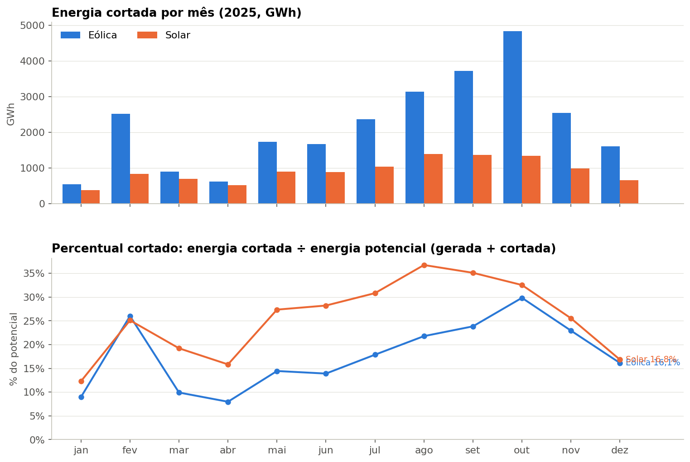
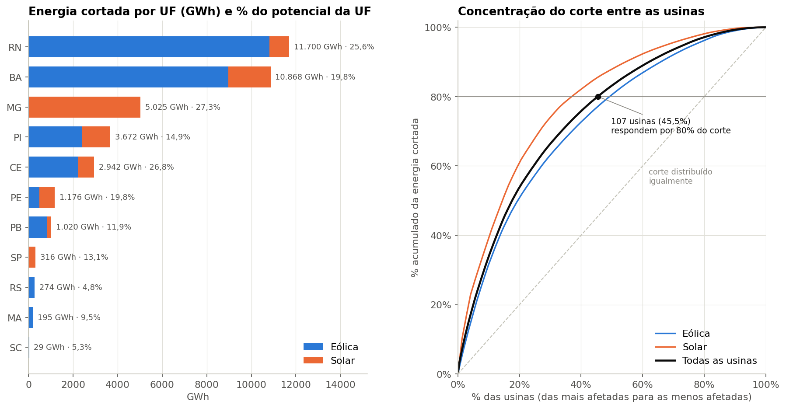
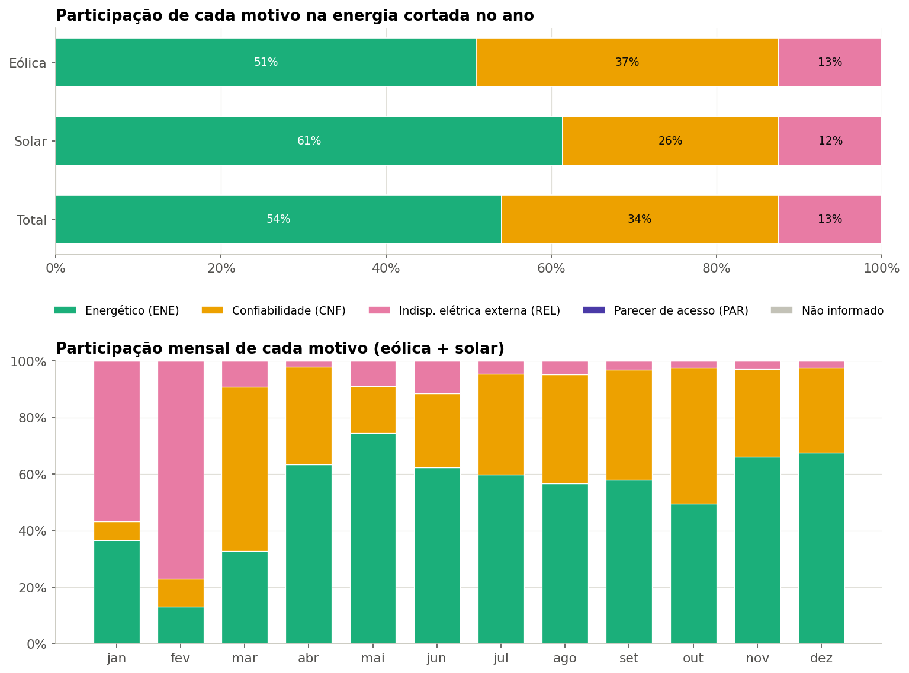
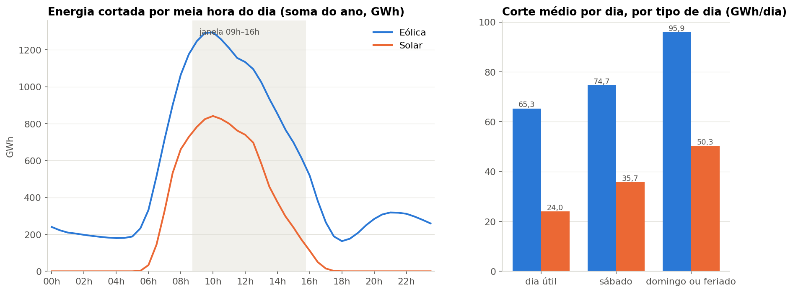
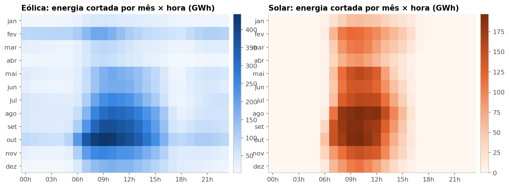
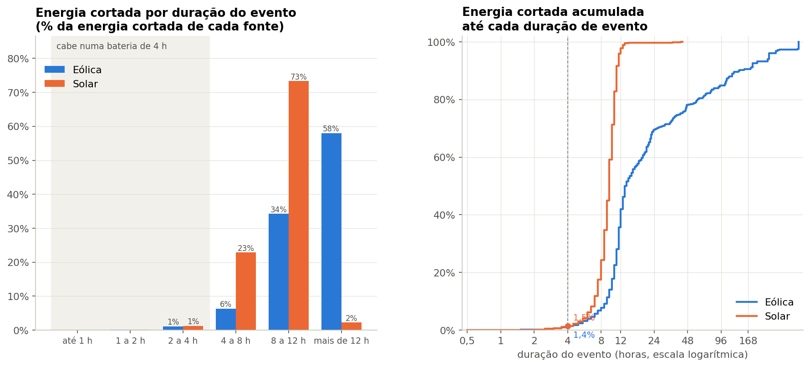

# MVP — Pipeline de dados em nuvem: cortes de geração eólica e solar no Sistema Interligado Nacional

[](https://colab.research.google.com/github/jplc08/mvp-cortes-renovaveis-ons/blob/main/mvp_cortes_renovaveis_ons.ipynb)


| | |
|---|---|
| **Instituição** | Universidade de Brasília (UnB) — Departamento de Engenharia de Produção |
| **Disciplina** | PSP8 |
| **Professor** | André Luiz Marques Serrano |
| **Aluno** | João Pedro Lima de Carvalho — matrícula 231013402 |
| **Natureza** | Trabalho individual |
| **Notebook** | [`mvp_cortes_renovaveis_ons.ipynb`](mvp_cortes_renovaveis_ons.ipynb), versionado **com as saídas** da execução |

> **Resumo.** Quando a rede não consegue escoar a energia, ou quando há mais oferta do que consumo, o Operador Nacional do Sistema Elétrico (ONS) manda usinas eólicas e solares reduzirem a geração: é o **corte de geração** (*constrained-off* ou *curtailment*). Este MVP constrói um pipeline de dados em nuvem sobre os dados abertos do ONS para 2025, com **Google Drive** como Data Lake (camadas bronze, silver e gold) e **Google BigQuery** como Data Warehouse em modelo dimensional. Com ele, responde a cinco perguntas que apoiam uma decisão de política energética: **quanto se corta, onde, por quê, quando e por quanto tempo**, e, com isso, qual das três alavancas — **transmissão, armazenamento ou gestão da oferta e da demanda** — tem mais peso.

### Principais resultados

* Em 2025, eólicas e solares deixaram de gerar **37,2 TWh** por cortes: **20,7%** do que poderiam ter produzido (eólica 19,1%; solar 25,7%), o equivalente a **4,2 GW médios** parados o ano inteiro. De janeiro a agosto foram 18,1%, perto da estimativa de mercado de 17,6%.
* O corte piorou no 2º semestre (eólica de 14,1% para 22,6%; solar de 21,3% para 29,5%), com picos em outubro na eólica (29,8%) e em agosto na solar (36,8%).
* O problema é **do sistema, não de pontos isolados**: 84,4% da energia foi cortada em restrições de origem sistêmica, e são precisas 107 das 235 usinas (45,5%) para somar 80% do corte. RN (31,4%), BA (29,2%) e MG (13,5%) concentram 74,1%.
* O motivo **energético** (excesso de oferta) lidera, com 53,9%, e subiu de 45,7% no 1º para 58,0% no 2º semestre. Os motivos elétricos somam 46,1%, e dois terços deles também são sistêmicos.
* 61,7% do corte acontece entre 9h e 16h, e um domingo ou feriado tem **1,64 vez** o corte de um dia útil.
* Os eventos de corte são **longos** (mediana de 10 h na eólica e 8,5 h na solar). Eventos de até 4 h são 10,7% dos eventos, mas só **1,4% da energia**: baterias de 4 h não resolvem o problema sozinhas.
* Hipóteses: **H1 e H3 confirmadas**; H2, H4 e H5 não confirmadas. O pipeline processou 3,87 milhões de linhas, passou em 17/17 verificações de integridade e 7/7 reconciliações, e custa **US$ 0,00** por execução.

A leitura completa, gerada automaticamente pelo notebook, está em [`evidencias/resultados_resumo.md`](evidencias/resultados_resumo.md), e os números-chave em [`evidencias/resultados_numeros.json`](evidencias/resultados_numeros.json).

## Sumário

1. [Objetivo](#1-objetivo)
2. [Arquitetura e plataforma](#2-arquitetura-e-plataforma)
3. [Como reproduzir](#3-como-reproduzir)
4. [Busca e coleta](#4-busca-e-coleta)
5. [Qualidade dos dados](#5-qualidade-dos-dados)
6. [Transformação](#6-transformação)
7. [Modelagem e Catálogo de Dados](#7-modelagem-e-catálogo-de-dados)
8. [Carga no Data Warehouse e evidências](#8-carga-no-data-warehouse-e-evidências)
9. [Análise: solução do problema](#9-análise-solução-do-problema)
10. [Discussão geral](#10-discussão-geral)
11. [Viabilidade financeira](#11-viabilidade-financeira)
12. [Autoavaliação](#12-autoavaliação)
13. [Ética, licenciamento e proteção de dados](#13-ética-licenciamento-e-proteção-de-dados)
14. [Estrutura do repositório](#14-estrutura-do-repositório)
15. [Referências](#15-referências)

---

## 1. Objetivo

### Contexto e problema

A expansão eólica e solar no Brasil se concentra no Nordeste e no norte de Minas Gerais, longe dos grandes centros de consumo. O próprio ONS registra que os cortes cresceram depois da perturbação de 15/08/2023 e se concentram entre 9h e 16h, quando a geração solar atinge o pico e a carga líquida é mínima ([RT ONS DGL 0189/2025](https://www.ons.org.br/AcervoDigitalDocumentosEPublicacoes/RT%20DGL-ONS%200189-2025%20-%20GT%20Curtailment%20rev1.pdf)). Uma estimativa de mercado calculou que 17,6% da energia que eólicas e solares poderiam ter gerado entre janeiro e agosto de 2025 foi cortada, com prejuízo de cerca de R$ 3,2 bilhões ([Canal Solar, 23/09/2025](https://canalsolar.com.br/cortes-geracao-prejuizo-estimado-32-bi-2025/)).

Reduzir a energia renovável desperdiçada passa por três alavancas, com custos e prazos muito diferentes:

* **Transmissão:** obras de rede, que atacam cortes elétricos e de confiabilidade em pontos específicos;
* **Armazenamento:** baterias, que absorvem cortes de curta duração;
* **Gestão da oferta e da demanda:** sinais de preço por horário, resposta da demanda e coordenação da expansão (inclusive da geração distribuída), que atacam cortes por excesso de energia no sistema.

A decisão a apoiar é **como dividir o esforço entre essas alavancas**. Para isso é preciso saber quanto se corta, onde, por quê, quando e por quanto tempo.

### Perguntas de negócio

| # | Pergunta | Decisão que a resposta apoia |
|---|---|---|
| **P1** | Quanta energia eólica e solar deixou de ser gerada por cortes em 2025, quanto isso representa do potencial de cada fonte e como evoluiu mês a mês? | Dimensionar o problema e priorizar a fonte mais afetada. |
| **P2** | Em quais estados e em quais usinas os cortes se concentram? | Direcionar obras de transmissão e decisões de investimento para os pontos críticos. |
| **P3** | Por que se corta: qual a participação de cada motivo (energético, confiabilidade, indisponibilidade elétrica externa, parecer de acesso) e da origem (local ou sistêmica), e isso mudou ao longo do ano? | Escolher entre transmissão (motivos elétricos e locais) e gestão de oferta e demanda (motivo energético e sistêmico). |
| **P4** | Em que horários e dias os cortes acontecem para cada fonte? | Avaliar deslocamento de carga e sinais de preço por horário. |
| **P5** | Quanto duram os eventos de corte, e que parcela da energia cortada acontece em eventos de até 4 horas? | Avaliar o potencial de baterias de 4 horas. |

### Hipóteses e critérios de confirmação (definidos antes da análise)

| Hipótese | Pergunta | Enunciado | Critério de confirmação |
|---|---|---|---|
| **H1** | P1 | O corte é relevante. | Energia cortada **≥ 10%** do potencial em pelo menos uma das fontes, no ano. |
| **H2** | P2 | O corte é concentrado em poucas usinas. | **No máximo 20%** das usinas respondem por **80%** da energia cortada. |
| **H3** | P3 | A maior parte do corte tem motivo energético (excesso de oferta), e não elétrico. | Motivo **ENE ≥ 50%** da energia cortada. |
| **H4** | P4 | O corte se concentra no meio do dia. | **≥ 70%** da energia cortada entre **09h00 e 15h59**. |
| **H5** | P5 | Baterias de 4 horas absorveriam a maior parte do corte. | **≥ 50%** da energia cortada em eventos de **até 4 horas**. |

O notebook avalia cada critério automaticamente (Seção 10) e grava o veredito em [`evidencias/tabelas/d1_avaliacao_hipoteses.csv`](evidencias/tabelas/d1_avaliacao_hipoteses.csv).

**Escopo:** usinas eólicas e solares fotovoltaicas das modalidades Tipo I, II-B e II-C (operadas centralmente pelo ONS), de janeiro a dezembro de 2025, em base semi-horária. **Fora do escopo:** geração distribuída (não é cortada pelo ONS), valoração financeira das perdas e previsão de cortes futuros.

### As três dimensões do MVP

| Dimensão | Evidência neste trabalho |
|---|---|
| Viabilidade técnica | Pipeline ponta a ponta no Colab, com dados persistidos no Drive e no BigQuery e evidências visuais geradas a partir das próprias plataformas ([seções 4 a 8](#4-busca-e-coleta)). |
| Viabilidade financeira | Consumo de armazenamento e de consulta **medido** em cada execução ([seção 11](#11-viabilidade-financeira)). |
| Desejabilidade | P1 a P5 respondidas com dados e ligadas às três alavancas de decisão ([seções 9 e 10](#9-análise-solução-do-problema)). |

## 2. Arquitetura e plataforma



| Camada | Onde | Formato | Conteúdo |
|---|---|---|---|
| Bronze | Drive · `mvp_cortes_renovaveis/bronze/ons/<fonte>/ano=2025/` | Parquet original | Os arquivos mensais exatamente como publicados + dicionários de dados + `_metadados_coleta.json` |
| Silver | Drive · `mvp_cortes_renovaveis/silver/` | Parquet | `restricoes_eolica`, `restricoes_solar` (usina × meia hora, tipadas, com energia em MWh rateada por motivo) e `usinas` |
| Gold | Drive · `mvp_cortes_renovaveis/gold/` **e** BigQuery · `ons_cortes_dw` | Parquet + tabelas | `fato_restricao`, `fato_evento_corte`, `dim_usina`, `dim_data`, `dim_horario`, `dim_restricao` + 5 tabelas `meta_*` |

**Por que essa plataforma.** O **Colab** executa o pipeline em Python, sem instalação, e se integra nativamente ao Drive e ao BigQuery. O **Drive** é armazenamento em nuvem persistente, organizado em camadas (arquitetura *medallion*). O **BigQuery Sandbox** é um Data Warehouse gratuito, sem cartão de crédito. Suas limitações foram tratadas no desenho:

* **Sem DML:** a carga usa *load jobs* com `WRITE_TRUNCATE`, o que a torna **idempotente** (reexecutar substitui as tabelas, sem duplicar linhas);
* **Tabelas expiram em 60 dias:** a gold fica também em Parquet no Drive, de onde é recarregada com uma execução;
* **Partições expiram em 60 dias a partir da data da partição:** por isso a fato **não** é particionada por mês (as partições de 2025 seriam apagadas na hora).

**Robustez da execução.** O notebook valida o `PROJECT_ID` **antes** de qualquer processamento: recusa o número do projeto (só dígitos) e, se o ID não existir na conta, lista os projetos disponíveis. A coleta compara o `ETag` de cada arquivo com o da última coleta: arquivos iguais são reaproveitados do Drive e arquivos revisados pelo ONS são baixados de novo, com a revisão registrada.

## 3. Como reproduzir

1. Crie (ou reaproveite) um projeto no Google Cloud (<https://console.cloud.google.com/projectcreate>) e abra o console do BigQuery uma vez para ativar o *sandbox*.
2. Copie o **ID do projeto**, que aparece no seletor de projetos e tem letras, hífens e, em geral, números no final (por exemplo, `meu-projeto-123456`). Não use o número do projeto (só dígitos).
3. Clique em **Abrir no Colab** (topo desta página), preencha `PROJECT_ID` na célula de parâmetros e execute **Ambiente de execução → Executar tudo**. Autorize o Drive e a conta Google quando solicitado.
4. Ao final, o notebook baixa `evidencias_mvp_cortes_ons.zip` (também gravado no Drive), já na estrutura deste repositório: `evidencias/`, `catalogo/` e `scripts/sql/`.

Fora do Colab, a coleta pode ser reproduzida com [`scripts/coleta_ons.py`](scripts/coleta_ons.py), e o modelo recriado com [`scripts/ddl_modelo_dimensional.sql`](scripts/ddl_modelo_dimensional.sql). Dependências em [`requirements.txt`](requirements.txt).

## 4. Busca e coleta

**Fonte:** ONS Dados Abertos, conjuntos *Restrição de Operação por Constrained-off* de [usinas eólicas](https://dados.ons.org.br/dataset/restricao_coff_eolica_usi) e de [usinas fotovoltaicas](https://dados.ons.org.br/dataset/restricao_coff_fotovoltaica_usi). A base foi escolhida **depois** de definido o problema, porque traz exatamente o que as perguntas exigem:

| Necessidade das perguntas | Atributo na base do ONS |
|---|---|
| Energia cortada e potencial (P1) | `val_geracao`, `val_geracaoreferencia`, `val_geracaoreferenciafinal`, `val_geracaonaorealizadaapurada` |
| Localização (P2) | `id_estado`, `id_subsistema`, `id_ons`, `nom_usina`, `id_pontoconexao`, `nom_agenteoperador` |
| Motivo e origem (P3) | `cod_razaorestricao` (REL, CNF, ENE, PAR), `cod_origemrestricao` (LOC, SIS), minutos restritos por motivo |
| Horário e duração (P4, P5) | `din_instante`, em base semi-horária |

**Coleta:** download HTTP dos arquivos Parquet mensais publicados num repositório público (Amazon S3), sem login e sem *web scraping*. O Parquet é cerca de dez vezes menor que o CSV publicado e preserva os tipos. Os dois conjuntos têm as mesmas 24 colunas, documentadas nos dicionários de dados do ONS, que também são baixados.

**Reprodutibilidade:** para cada arquivo, [`evidencias/metadados/_metadados_coleta.json`](evidencias/metadados/_metadados_coleta.json) registra URL, linhas, tamanho, `ETag`, `Last-Modified`, SHA-256 e status (baixado, reaproveitado ou revisado), além da data e hora da coleta. A mesma informação fica na tabela `meta_coleta` do BigQuery.

| Item | Valor registrado |
|---|---|
| **Data da coleta** | 21/10/2026, 09:45 (UTC-3) |
| **Arquivos** | 24 Parquet mensais de 2025 (12 eólica + 12 fotovoltaica), todos publicados, e os 2 dicionários de dados |
| **Volume** | 58,38 MB · 3.874.032 linhas · 235 usinas ou conjuntos de usinas |
| **Eólica** | 209.664 a 232.128 linhas por mês (3,1 a 4,4 MB) |
| **Fotovoltaica** | 87.360 a 105.168 linhas por mês (0,9 a 1,2 MB) |
| **Versão publicada** | `Last-Modified` de 10 e 11/09/2026: os arquivos de 2025 foram atualizados pelo ONS quase um ano depois do período a que se referem, o que justifica o controle de revisões por `ETag` |

## 5. Qualidade dos dados

A análise de qualidade vem **antes** da transformação e define as regras de tratamento. Ela tem quatro partes, todas exportadas para `evidencias/tabelas/`:

| Parte | O que examina | Evidência |
|---|---|---|
| Perfil por atributo | As 24 colunas de cada fonte: tipo esperado, nulos, distintos, conformidade com o domínio, mínimo, máximo e valores mais frequentes | [`q1_perfil_por_atributo.csv`](evidencias/tabelas/q1_perfil_por_atributo.csv) |
| Deriva de esquema | Colunas ausentes, extras ou com tipo diferente entre os arquivos mensais | [`q2_deriva_de_esquema.csv`](evidencias/tabelas/q2_deriva_de_esquema.csv) |
| Verificações por dimensão | Unicidade, completude, consistência, conformidade e acurácia, cada uma com o tratamento adotado | [`q3_verificacoes_por_dimensao.csv`](evidencias/tabelas/q3_verificacoes_por_dimensao.csv) |
| Cobertura temporal | Meias horas presentes ÷ esperadas, por fonte, usina e mês | [`q4_cobertura_mensal.csv`](evidencias/tabelas/q4_cobertura_mensal.csv) · [gráfico](evidencias/graficos/q4_cobertura_mensal.png) |

| Dimensão | O que foi examinado | Tratamento |
|---|---|---|
| **Unicidade** | Chave (fonte, usina, instante), inclusive entre arquivos | R04 |
| **Completude** | Campos obrigatórios; intervalos restritos sem motivo, sem energia não gerada ou sem referência; descrição da restrição (existe só a partir de set/2025) | R07, R09, R10 |
| **Consistência** | Energia não gerada publicada × recalculada; minutos por motivo × minutos restritos; geração × disponibilidade; atributos da usina que mudam no ano | R06, R08, R09, R10 |
| **Conformidade** | Domínios (motivos, origens, subsistemas, UFs); passo de 30 minutos; minutos entre 0 e 30; ano do recorte; deriva de esquema | R01, R02, R03, R05, R13 |
| **Acurácia** | Valores negativos; energia não gerada maior que a referência | R05; valores oficiais mantidos e sinalizados |
| **Atualidade** | Meses publicados e data de modificação de cada arquivo (o ONS revisa meses já publicados) | Coleta idempotente por `ETag` |

**O que a análise encontrou.** Estruturalmente, a base do ONS é limpa: nenhuma duplicata, nenhum valor negativo, nenhum instante fora do passo de 30 minutos, nenhuma deriva de esquema entre os 24 arquivos e cobertura de 99,6% das meias horas esperadas. Os achados ficaram nas regras de negócio:

* **36** intervalos restritos sem motivo (0,003%) e **51** valores de minutos fora de 0 a 30 → R09 e R05;
* energia não gerada apurada (GNRa) diferente de max(0, referência − geração) em **2,5%** dos intervalos restritos e maior que a própria referência em **2,2%** → mantido o valor oficial do ONS, com o achado registrado;
* geração acima da disponibilidade declarada em **2,4%** dos registros → sinalizada em `flag_geracao_acima_disponibilidade` (R08);
* **17** das 235 usinas mudaram de estado, subsistema, agente ou ponto de conexão no ano → R10;
* descrição da restrição ausente em 57,4% dos intervalos restritos, o que é esperado: o campo só existe a partir de setembro de 2025;
* pico médio da geração solar às 14h, dentro da faixa esperada: sem indício de fuso horário trocado.

## 6. Transformação

Catorze regras (R01 a R14) levam a bronze à silver e à gold. As centrais para o resultado:

* **Energia cortada (R07):** a energia não gerada apurada pelo ONS (GNRa), que é o valor oficial. Quando ela falta num intervalo restrito, é recalculada como max(0, referência − geração); sem as duas, fica 0 (subestimação conservadora).
* **Unidades (R08):** o ONS publica potências médias da meia hora (MWmed). Só a energia (MWh = MWmed × 0,5 h) é somada.
* **Rateio por motivo (R09):** uma meia hora pode ter minutos de mais de um motivo; a energia é rateada pela proporção dos minutos, e as parcelas somam exatamente o total.
* **Eventos (R12):** meias horas restritas consecutivas da mesma usina formam um evento, com duração, energia e motivo predominante.

Todas as regras, com justificativa, o problema de qualidade que tratam e a linhagem coluna a coluna, estão em [`catalogo/regras_transformacao.md`](catalogo/regras_transformacao.md). Cada aplicação registra as linhas afetadas em [`evidencias/tabelas/m3_log_transformacoes.csv`](evidencias/tabelas/m3_log_transformacoes.csv) e na tabela `meta_log_transformacoes`.

## 7. Modelagem e Catálogo de Dados

**Modelo:** constelação de fatos (Kimball), com duas tabelas fato que compartilham quatro dimensões conformadas.



| Tabela | Grão | Papel nas perguntas |
|---|---|---|
| `fato_restricao` | Usina × meia hora | P1 a P4: energia gerada, cortada e potencial (MWh), rateada por motivo |
| `fato_evento_corte` | Evento contínuo de corte de uma usina | P5: duração, energia, potência máxima cortada |
| `dim_usina` | Usina | P2: fonte, UF, subsistema, ponto de conexão, agente |
| `dim_data` | Dia | P1, P4: mês, tipo de dia (útil, sábado, domingo ou feriado) |
| `dim_horario` | Meia hora do dia | P4: hora e janela do meio-dia |
| `dim_restricao` | Motivo × origem | P3: natureza do motivo e alavanca de política associada |

As decisões de modelagem (por que duas fatos, por que data e horário separados, aditividade das medidas) estão em [`catalogo/modelo_dados.md`](catalogo/modelo_dados.md).

**Catálogo de Dados:** [`catalogo/catalogo_dados.md`](catalogo/catalogo_dados.md) (também em [CSV](catalogo/catalogo_dados.csv) e na tabela `meta_catalogo_dados`). Para cada um dos 87 atributos: tipo, tipo lógico, descrição, **domínio** (faixa mínima e máxima, valores válidos ou padrão), obrigatoriedade, significado do nulo e **linhagem** (coluna de origem no ONS e regras aplicadas). O catálogo é definido **uma única vez** no notebook e gera três produtos: a documentação, o esquema do BigQuery (tipos, `REQUIRED`/`NULLABLE` e descrição de cada coluna) e a validação automática dos dados contra os domínios ([`m2_validacao_catalogo.csv`](evidencias/tabelas/m2_validacao_catalogo.csv)).

## 8. Carga no Data Warehouse e evidências

Cada tabela gold é carregada por *load job* com o esquema do catálogo e `WRITE_TRUNCATE`. Uma coluna obrigatória com nulo faz a carga falhar, o que funciona como trava de integridade. Depois da carga, o notebook relê o BigQuery e verifica:

* **persistência:** tabelas, linhas, tamanho, data de criação e expiração ([`c2_tabelas_persistidas.csv`](evidencias/tabelas/c2_tabelas_persistidas.csv));
* **integridade** por SQL: unicidade das chaves, chaves estrangeiras sem correspondência, rateio por motivo igual ao total e energia cortada só em intervalos restritos ([`c3_integridade_referencial.csv`](evidencias/tabelas/c3_integridade_referencial.csv));
* **reconciliação** Drive × BigQuery: linhas, usinas, intervalos restritos, energia gerada e cortada e eventos ([`c4_reconciliacao.csv`](evidencias/tabelas/c4_reconciliacao.csv)).

Na execução registrada, foram carregadas 11 tabelas: a `fato_restricao` com 3.874.032 linhas (549,6 MB), a `fato_evento_corte` com 67.782 eventos, as quatro dimensões e as cinco tabelas de metadados. As **17 verificações de integridade** e as **7 métricas de reconciliação** deram OK, e a energia somada nos eventos é igual à energia cortada da fato semi-horária.

**Evidências visuais.** Em vez de capturas de tela manuais, o notebook desenha as evidências **a partir de dados lidos na hora** do Drive montado e da API do BigQuery:

| Evidência | O que mostra |
|---|---|
| [E1 — Data Lake no Drive](evidencias/imagens/e1_data_lake_drive.png) | Arquivos das camadas bronze, silver e gold, com tamanho e data de modificação |
| [E2 — Tabelas no BigQuery](evidencias/imagens/e2_tabelas_bigquery.png) | Tabelas do dataset, com linhas, tamanho, data de criação e expiração |
| [E3 — Esquema no BigQuery](evidencias/imagens/e3_esquema_bigquery.png) | Colunas da `fato_restricao` com tipo, modo e descrição gravados a partir do catálogo |
| [E4 — Integridade e reconciliação](evidencias/imagens/e4_integridade_reconciliacao.png) | Resultado de cada verificação por SQL |
| [E5 — Consultas executadas](evidencias/imagens/e5_consultas_bigquery.png) | Identificador do job, bytes processados e horário de cada consulta |

O próprio notebook, versionado com as saídas, é a evidência principal: cada etapa pode ser conferida no GitHub sem reexecutar. O SQL de todas as consultas está em [`scripts/sql/`](scripts/sql/).

## 9. Análise: solução do problema

Todas as respostas partem de **consultas SQL no BigQuery** sobre o modelo dimensional; o Python entra depois, para testes estatísticos e gráficos. O **percentual cortado** é sempre energia cortada ÷ energia potencial (gerada + cortada), calculado sobre somas. Cada pergunta termina com uma **leitura automática** gerada a partir dos números, reunidas em [`evidencias/resultados_resumo.md`](evidencias/resultados_resumo.md).

### P1 — Quanta energia foi cortada e como evoluiu?

Energia gerada, cortada e potencial por fonte e mês; tendência ao longo do ano (Spearman) e comparação entre semestres; comparação do período de janeiro a agosto com a estimativa de mercado citada no contexto.



**Resultado.** **37,22 TWh** cortados, **20,7%** do potencial: eólica 26,22 TWh (19,1%) e solar 11,00 TWh (25,7%). 37,0% dos intervalos usina × meia hora tiveram alguma restrição. O corte foi maior no 2º semestre nas duas fontes, com picos em outubro na eólica (29,8%) e em agosto na solar (36,8%). A tendência ao longo do ano é positiva, mas não significativa com 12 meses (eólica ρ = 0,51, p = 0,090; solar ρ = 0,47, p = 0,124). De janeiro a agosto, o percentual foi de 18,1%, a mesma ordem de grandeza da estimativa de mercado (17,6%). **H1 confirmada.**

### P2 — Onde os cortes se concentram?

Energia cortada e percentual por UF e fonte; curva de concentração entre as usinas e quantas usinas respondem por 80% do corte (critério de H2).



**Resultado.** RN (31,4%), BA (29,2%) e MG (13,5%) concentram 74,1% da energia cortada, e o subsistema Nordeste, 84,3%. MG tem o maior percentual cortado entre as UFs relevantes (27,3% do seu potencial). Entre as usinas, o corte é **difuso**: são precisas 107 das 235 (45,5%) para somar 80%, e as 10 mais afetadas respondem por 17,6%. A mais afetada é o Conj. Janaúba (solar, MG), com 1,13 TWh cortados (33,5% do seu potencial). **H2 não confirmada.**

### P3 — Por que se corta?

Participação de cada motivo (pelo rateio da R09) por fonte e por mês; participação da origem local ou sistêmica; matriz motivo × origem.



**Resultado.** O motivo **energético (ENE)** responde por **53,9%** da energia cortada (eólica 50,8%; solar 61,3%), e os elétricos (CNF + REL) por 46,1%. Parecer de acesso e intervalos sem motivo são desprezíveis. **84,4%** da energia foi cortada em restrições de origem **sistêmica**. Mesmo entre os cortes elétricos, cerca de dois terços são sistêmicos, o que aponta para a capacidade de escoamento entre regiões, e não para gargalos de conexão de usinas específicas. A participação do motivo energético subiu de 45,7% no 1º semestre para 58,0% no 2º, variando de 13,1% (fevereiro) a 74,5% (maio). **H3 confirmada.**

### P4 — Quando se corta?

Perfil por meia hora do dia, mapa de calor mês × hora e corte médio por tipo de dia (útil, sábado, domingo ou feriado).




**Resultado.** **61,7%** da energia cortada aconteceu entre 09h00 e 15h59, uma janela com 29% das horas do dia: solar 76,3% e eólica 55,6% (a eólica ainda tem 21,3% do corte entre 18h e 6h). Nas duas fontes, a meia hora com mais corte é a das 10h00. Um domingo ou feriado tem **1,64 vez** o corte de um dia útil, e um sábado, 1,23 vez: o corte cresce quando a carga cai. **H4 não confirmada** (61,7% < 70%), embora a concentração no meio-dia seja o dobro da fração de horas da janela.

### P5 — Quanto duram os cortes?

Distribuição dos eventos e da energia por faixa de duração; curva acumulada da energia pela duração do evento; medianas, percentil 90 e teste de Mann-Whitney entre as fontes; energia em eventos de até 4 horas (critério de H5).



**Resultado.** Foram 64.439 eventos de corte com perda de energia. A duração mediana é de **10,0 h** na eólica e **8,5 h** na solar (P90 de 17,5 h e 10,5 h; máximo de 477 h na eólica), e as durações das duas fontes diferem significativamente (Mann-Whitney, p < 0,001). Eventos de até 4 h são 10,7% dos eventos, mas concentram só **1,4% da energia cortada**. No limite teórico, baterias de 4 h junto a cada usina recuperariam 524,7 GWh por ano, 1,4% do total. **H5 não confirmada.**

## 10. Discussão geral

As respostas se encadeiam: P1 dimensiona o problema; P2 mostra **onde** e se dá para atacá-lo de forma localizada; P3 mostra **por que** e, com isso, qual alavanca tem mais peso; P4 e P5 mostram **quando** e **por quanto tempo**, o que define se deslocar consumo ou armazenar funciona.

| Alavanca | Quando é a resposta certa | Evidência |
|---|---|---|
| **Transmissão** | Corte elétrico (REL, CNF), local e concentrado em poucas usinas ou pontos de conexão | P2, P3, P5 (eventos longos) |
| **Armazenamento** (baterias de 4 h) | Corte recorrente, de poucas horas, previsível | P4, P5 (energia em eventos curtos) |
| **Gestão de oferta e demanda** | Corte energético e sistêmico, em horas de carga baixa | P3 (ENE, SIS), P4 (meio-dia, domingos e feriados) |

| Hipótese | Resultado | Veredito |
|---|---|---|
| **H1** — o corte é relevante | eólica 19,1% · solar 25,7% do potencial | Confirmada |
| **H2** — o corte é concentrado em poucas usinas | 107 de 235 usinas (45,5%) somam 80% do corte | Não confirmada |
| **H3** — predomina o motivo energético | ENE 53,9% · elétricos (REL + CNF) 46,1% | Confirmada |
| **H4** — o corte se concentra no meio do dia | 61,7% entre 09h00 e 15h59 | Não confirmada |
| **H5** — baterias de 4 h absorveriam a maior parte | 1,4% da energia (10,7% dos eventos) | Não confirmada |

**O que os dados de 2025 dizem sobre as alavancas.**

* **Gestão da oferta e da demanda tem o maior peso.** O motivo energético é majoritário e cresceu no 2º semestre, e o corte aumenta 64% em domingos e feriados, quando a carga é menor. Sinais de preço por horário, resposta da demanda e coordenação da expansão (inclusive da geração distribuída, que reduz a carga líquida ao meio-dia) atacam a maior parcela.
* **Transmissão vem logo atrás, mas como escoamento entre regiões.** 46,1% do corte é elétrico, e cerca de dois terços dele têm origem sistêmica. Como o corte é difuso entre as usinas, reforços de conexão em poucos pontos resolveriam pouco; o que pesa são as interligações que levam a energia do Nordeste e de Minas Gerais aos centros de carga.
* **Baterias de 4 horas têm papel limitado.** Os eventos duram tipicamente de 8 a 10 horas, e só 1,4% da energia está em eventos que caberiam inteiros numa bateria de 4 h. O armazenamento ajuda se tiver maior duração ou se operar junto às outras alavancas. Uma bateria também absorveria parte de eventos mais longos, o que este MVP não simulou (ver autoavaliação).

**O que os dados não permitem concluir.** A análise é descritiva. A energia cortada depende da **geração de referência**, que o ONS estima com modelos de vento e irradiação. A base não traz preços, então o prejuízo financeiro não é calculado. A geração distribuída não é cortada e não aparece, embora contribua para o excesso de oferta ao meio-dia. A classificação de cada corte como energético ou elétrico é do operador.

## 11. Viabilidade financeira

O notebook mede, em cada execução, os bytes processados por **cada** consulta e o armazenamento ocupado no BigQuery e no Drive, e compara com as franquias gratuitas ([`f1_consultas_bigquery.csv`](evidencias/tabelas/f1_consultas_bigquery.csv), [`f2_custos.csv`](evidencias/tabelas/f2_custos.csv)). | Recurso | Uso medido | Franquia gratuita | % da franquia | Custo sem franquia |
|---|---|---|---|---|
| BigQuery — consultas (uma execução completa) | 1.395,1 MB em 13 consultas | 1 TiB por mês | 0,13% | US$ 0,0083 |
| BigQuery — armazenamento | 556,6 MB | 10 GiB | 5,44% | US$ 0,0109 por mês |
| Google Drive — Data Lake e evidências | 289,6 MB | 15 GB | 2,02% | — |
| Google Colab — processamento | 1 sessão de CPU | uso gratuito com limites | — | — |

O pipeline cabe com folga nas franquias gratuitas: mesmo com 30 execuções por mês, as consultas usariam 3,99% da franquia. **Custo operacional: US$ 0,00.** Sem franquia, com os preços públicos do BigQuery sob demanda (US$ 6,25 por TiB processado; US$ 0,02 por GiB por mês), o custo seria de cerca de US$ 0,02 por mês: irrelevante diante de 37 TWh de energia cortada por ano.

## 12. Autoavaliação

| Pergunta | Situação | Observação |
|---|---|---|
| P1 — quanto se corta | Respondida | Energia e percentual por fonte e mês, com comparação externa. |
| P2 — onde | Respondida | UF, subsistema, usina e agente; o ponto de conexão está na `dim_usina`, mas não foi analisado separadamente. |
| P3 — por que | Respondida, com ressalva | Depende da classificação de motivo do ONS e do rateio por minutos; a parcela sem motivo é medida. |
| P4 — quando | Respondida | Não cruza com a carga do SIN, que está em outro conjunto do ONS. |
| P5 — duração e baterias | Parcialmente | A duração é medida; o potencial das baterias considera só eventos que caberiam inteiros numa bateria de 4 h, sem simular carga e descarga em eventos longos. |

**Limitações dos dados:** geração de referência estimada (não medida); só usinas operadas pelo ONS (sem geração distribuída); meses revisados pelo ONS depois da publicação; descrição da restrição só a partir de set/2025; sem preços.

**O que eu faria de outra forma:** carga incremental por mês com `MERGE` (fora do *sandbox*), reprocessando só os meses cujo `ETag` mudou; testes de qualidade declarativos (dbt tests ou Great Expectations); módulos separados orquestrados por um agendador.

**Extensões para uso contínuo:** ingestão mensal agendada; integração com a carga do SIN e com o PLD, para medir a carga líquida no momento do corte e valorar a energia perdida; painel no Looker Studio com alertas; simulação de baterias com a série semi-horária.

**Dificuldades:** entender a semântica das colunas (MWmed × energia, referência × referência final, minutos sem coluna para PAR); escolher o grão e criar a segunda fato para a pergunta de duração; processar milhões de linhas semi-horárias dentro da memória do Colab gratuito.

## 13. Ética, licenciamento e proteção de dados

* **Licença dos dados:** Creative Commons Atribuição (CC BY), conforme o portal ONS Dados Abertos. A atribuição é feita aqui, no notebook e nos metadados: *Fonte: Operador Nacional do Sistema Elétrico (ONS) — ONS Dados Abertos*. Mesmo sendo redistribuível, o dado bruto **não é versionado** neste repositório: o ONS revisa os arquivos depois da publicação, e o script de coleta sempre busca a versão oficial.
* **Licença do código:** MIT ([LICENSE](LICENSE)).
* **Dados pessoais (LGPD):** não há. Os registros identificam usinas e agentes operadores (pessoas jurídicas) e trazem medidas físicas de geração.
* **Coleta:** download direto de arquivos públicos, sem login e sem *web scraping*.

## 14. Estrutura do repositório

```
.
├── mvp_cortes_renovaveis_ons.ipynb   # notebook executado (com saídas) — abre direto no Colab
├── README.md
├── LICENSE                           # MIT (código)
├── requirements.txt
├── catalogo/
│   ├── catalogo_dados.md / .csv      # Catálogo de Dados (gerado pelo notebook)
│   ├── modelo_dados.md               # modelo dimensional e decisões de modelagem
│   ├── modelo_dimensional.png        # diagrama gerado do catálogo
│   └── regras_transformacao.md       # regras R01–R14 e linhagem por coluna
├── scripts/
│   ├── coleta_ons.py                 # coleta independente, com ETag e SHA-256
│   ├── ddl_modelo_dimensional.sql    # DDL do modelo, com PK e FK declaradas
│   └── sql/                          # SQL de cada consulta executada no BigQuery
└── evidencias/
    ├── README.md                     # onde cada etapa é comprovada
    ├── resultados_resumo.md          # leitura automática dos resultados
    ├── resultados_numeros.json       # números-chave de P1 a P5 e hipóteses
    ├── graficos/                     # gráficos de P1 a P5, cobertura e modelo
    ├── imagens/                      # evidências visuais E1 a E5 (Drive e BigQuery)
    ├── tabelas/                      # resultados de qualidade, carga, consultas e custos (CSV)
    └── metadados/                    # _metadados_coleta.json, perfil e log de transformações
```

## 15. Referências

* OPERADOR NACIONAL DO SISTEMA ELÉTRICO (ONS). *Restrição de Operação por Constrained-off de Usinas Eólicas* e *de Usinas Fotovoltaicas*. ONS Dados Abertos. <https://dados.ons.org.br/dataset/restricao_coff_eolica_usi> e <https://dados.ons.org.br/dataset/restricao_coff_fotovoltaica_usi>. Licença CC BY.
* ONS. *RT DGL-ONS 0189/2025 — GT Curtailment*. <https://www.ons.org.br/AcervoDigitalDocumentosEPublicacoes/RT%20DGL-ONS%200189-2025%20-%20GT%20Curtailment%20rev1.pdf>.
* CANAL SOLAR. Reportagem sobre o estudo da Volt Robotics a respeito do prejuízo estimado com cortes de geração em 2025. 23 set. 2025. <https://canalsolar.com.br/cortes-geracao-prejuizo-estimado-32-bi-2025/>.
* KIMBALL, R.; ROSS, M. *The Data Warehouse Toolkit: The Definitive Guide to Dimensional Modeling*. 3. ed. Wiley, 2013.
* GOOGLE CLOUD. *BigQuery sandbox* e *BigQuery pricing*. <https://cloud.google.com/bigquery/docs/sandbox> e <https://cloud.google.com/bigquery/pricing>.
* BRASIL. Lei nº 13.709, de 14 de agosto de 2018 — Lei Geral de Proteção de Dados Pessoais (LGPD).
